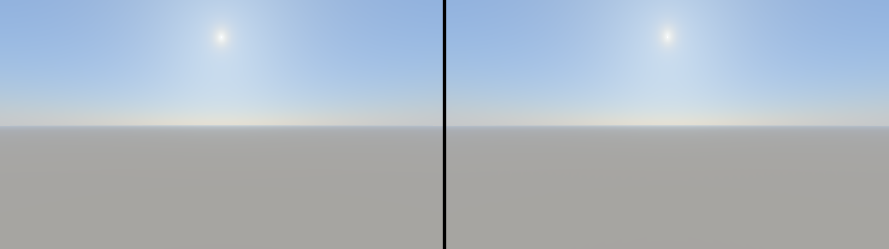
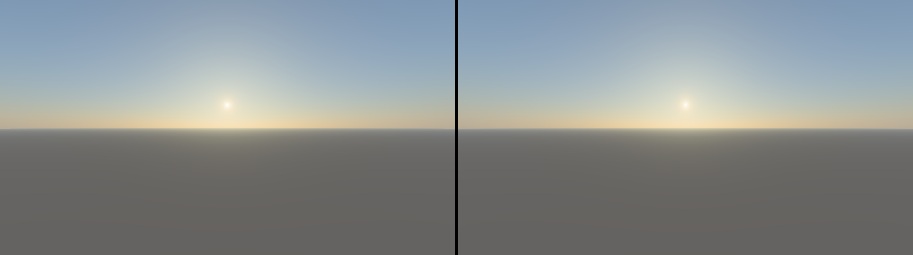
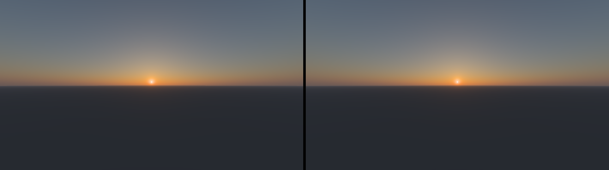
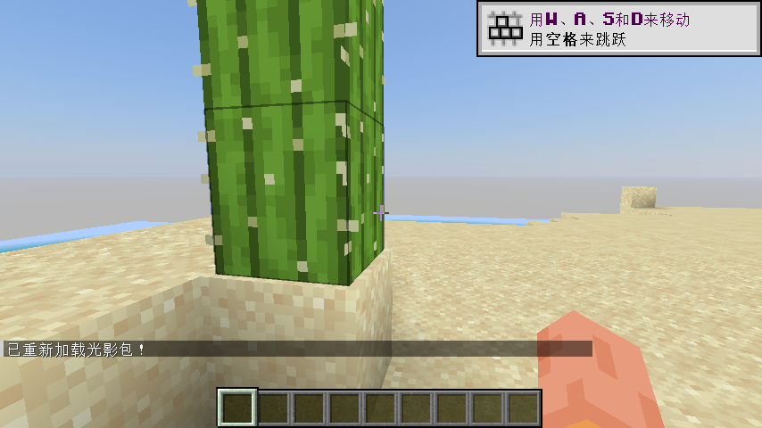

# 把天空搬进 Minecraft

光影包把 [sky-tracer](atmosphere.md) 的**四波长实时求解器**接入 Minecraft，而不是另写一套“天空近似”：固定介质（光学厚度、方向性多重散射源、相位与体剖面）由本仓库 GPU 求解一次后离线烘焙，太阳连续变化的部分留在着色器里每帧重建。地形、方块光照、雾和水仍由最小 `gbuffers` 程序按原版方式着色，因此这是一个**天空光影包**，不是完整的光照/阴影光影包。

产物默认写到 `out/shaderpacks/SkyTracer/`（被 `.gitignore` 忽略），由 `apps/sky-pack` 生成；仓库里跟踪的是着色器源、烘焙工具和下文的数据布局。

|关注的东西|位置|
|---|---|
|着色器源（Iris/OptiFine 格式）|[`mc/SkyTracer/`](../mc/SkyTracer)|
|烘焙 + 离线验证工具|[`apps/sky-pack/`](../apps/sky-pack)|
|烘焙产物|`out/shaderpacks/SkyTracer/`|
|离线验证报告|`out/mc-preview/report.json`|

## 为什么能“离线烘焙一半”

实时求解器把工作按变化频率拆分（见[实时方案](realtime.md)）：

|变化|包里的做法|
|---|---|
|启动、大气、反照率、求解配置|`sky-pack bake` 用 `sky-realtime` 的 GPU 求解器算一次，导出四波长纹理|
|太阳高度、观察海拔|`deferred` pass 每帧重建 256×256 全天球 SkyView，64 步输运/纹素|
|相机方向、窗口尺寸|`composite` pass 只做采样、太阳圆盘和显示变换|

太阳方位不需要单独重建：固定介质在球对称下与方位无关，SkyView 在“太阳方位坐标系”里积分，采样时只用到视线与太阳的方位夹角。

## 管线

```text
cargo run -p sky-pack -- bake
    sky-realtime GPU 求解 8 轮 -> 读回
      tau.bin      RGBA16F  512x128    光学厚度查找表
      source.bin   RGBA16F  3200x240   方向性多重散射源
      atlas.bin    RGBA32F  1024x114   所有系数表（见下）
      atmosphere_data.glsl            几何、四波长权重、映射系数等常量

Minecraft 每帧
    gbuffers_terrain/water.vsh/fsh   写 colortex0
        - 反照率 × 顶点色 × lightmap，原版线性/指数雾与 alpha test
        - 没有它 Sodium 会跳过区块几何（见“实机验证”）
    deferred.vsh/fsh   写 colortex5（256x256 RGBA16F，log Rec.2020）
        - 在太阳方位坐标系里按固定解析映射重建全天球 SkyView
        - 每纹素 = 项目 transport.wgsl 的 64 步四波长积分
    composite.vsh/fsh   写 colortex0
        - depth==1 的像素：采样 SkyView、加太阳圆盘、显示变换
        - 其他像素：原样输出（刚由 gbuffers 写入的地形/水）
        - 其他维度或水下：整帧原样输出
```

`deferred` 写固定尺寸缓冲区，分辨率与屏幕无关；`composite` 才是全屏 pass。这样 1080p 下天空积分成本只有 256²×64 步，而不是每像素 64 步——与项目里 SkyView 的取舍一致。

地形/水使用最小 `gbuffers` 程序：只做“贴图 × 顶点色 × lightmap”并沿用原版雾，不提供自定义光照、阴影、SSAO 或水面效果。实体、粒子、手、天气、天空等仍走 Iris 的内置回退程序。

## 系数表布局

`atlas.bin` 是一张 RGBA32F 图集，行号是固定的，烘焙时写进 `lib/atmosphere_data.glsl` 的常量里：

|行|内容|宽度|
|---|---|---|
|0–6|高度剖面：高度、消光、5 个散射组分（每行一个分量）|`profile_nodes`|
|7|SkyView 高度节点|40|
|8|地面辐照度（单行）|160|
|9–48|log 入射均值，逐高度节点|160|
|49–52|拟合相位表（4 个气溶胶组分 × 1024 bin）|1024|
|53–92|逐高度太阳坐标拟合系数（4 个 vec4/层）|4|
|93–113|高空 Rayleigh 精确二次型（5 个 RGBA tick/状态）|800|

`tau.bin` 是太阳方向光学厚度查找表（高度轴 × 太阳角），`source.bin` 是方向性多重散射源的球面展开。

## GLSL 函数地图

|函数|作用|
|---|---|
|`ath_medium`|按高度在剖面节点间插值，得到消光与 5 个散射组分|
|`ath_sun_t`|查 `tau.bin` 得到太阳方向透射率|
|`ath_solar_layer` / `ath_indirect`|拟合的高空源函数与多重散射项|
|`ath_integrate`|64 步四波长输运，对应 `transport.wgsl`|
|`sky_lut_build_radiance`|逐 LUT 纹素方向积分并转 Rec.2020|
|`sky_lut_uv` / `sky_lut_sample`|固定解析映射与 SkyView 采样|
|`ath_sun_disk`|太阳圆盘及其穿越大气的透射率|
|`display_from_rec2020`|Enhanced Reinhard / Oklab 显示变换|

## 两处实现取舍

1. SkyView 坐标使用**固定解析映射**（高度方向 `sin(e)=sign(2v-1)·(2v-1)^2`，方位方向 `u=sin(φ/2)`），换取“太阳一动就能重建”的简单实现；项目原来的映射是按太阳高度/观察海拔拟合的，需要 CPU 每次重建坐标表，放进 MC 没有对应生命周期。
2. 太阳方位由采样时的相对夹角处理，不会出现“只有朝向太阳才正确”的问题。太阳圆盘默认放大 4 倍物理角径（约 2.1°，可调），因为真实的 0.53° 在 MC 里看起来只是一个小点。

## 离线验证

`sky-pack preview` 是数值回归入口：用本机 OpenGL 4.6 兼容性上下文（隐藏 Win32 窗口 + WGL）编译**包里真实的 `#version 330 compatibility` 文件**，把 `deferred`/`composite` 两遍完整跑一遍，再与 `sky-realtime` 的逐像素 64 步输运（`use_sky_view=false`，同一介质、同一观察者）比较线性 Rec.2020 辐亮度。

覆盖的内容：

- GLSL 编译与链接（包括 `ftransform`、`gl_TextureMatrix`、原始纹理采样、RGBA16F 渲染目标）
- LUT 重建 + 采样 + 太阳盘 + 显示变换的完整片元路径
- `depth<1` 与“其他维度”必须逐字节原样输出的穿通分支
- 太阳盘辐亮度比（包 / 逐像素参考）

不覆盖的内容：Iris 的 pass 调度与原始纹理装载、`size.buffer` 与固定尺寸缓冲区、真实 MC 深度/矩阵。这些后来在同一台机器上用真实游戏补验了，见下一节；离线工具仍是日常回归手段。

最近一次本机结果（AMD Radeon 8060S / OpenGL 4.6，960×540，64 步，观察海拔 0.07 km）：

|太阳高度|线性辐亮度相对差 P50|P95|P99|太阳盘辐亮度比|SkyView 重建|合成|
|---|---:|---:|---:|---:|---:|---:|
|+35°|0.055%|0.373%|2.018%|1.0001|1.27 ms|1.71 ms|
|+10°|0.168%|1.130%|1.643%|0.9962|1.31 ms|1.86 ms|
|+2°|0.189%|1.024%|1.335%|0.9997|1.28 ms|1.86 ms|
|−2°|0.222%|1.090%|1.346%|—|1.23 ms|1.99 ms|
|−6°|0.518%|1.425%|1.688%|—|1.21 ms|1.69 ms|
|−12°|0.615%|1.490%|1.740%|—|1.17 ms|1.69 ms|

参考基线是同样 64 步的逐像素输运，因此这些数字衡量的是“LUT 插值 + 四波长→Rec.2020 + 纹理精度”的近似误差，不是物理模型误差；项目自己的 SkyView 对逐像素积分的 P95 在本机文档里约 0.5%–1.1%，同一量级。P99/最大值集中在太阳附近的窄前向峰与地平线附近。

误差是确定性的；毫秒列来自同一台共享显存的 iGPU，重复运行时抖动明显（曾观察到 1.2–4.3 ms 的 SkyView 重建），只作数量级参考。`composite` 的开销随屏幕像素数增长，`SkyView` 重建与分辨率无关。

图像对比（左：逐像素参考；右：光影包，均为同一显示变换）：





## 实机验证与两处修正

在 MC 1.20.1 + Fabric Loader 0.19.5 + Iris 1.7.6 + Sodium 0.5.13（AMD 8060S，854×480）上实际运行后，最初版本出现了两个离线验证覆盖不到的问题，都已修复：

1. **天空是均匀灰色。** 原因：`colortex5Format` 指令写成了单行块注释 `/* const int colortex5Format = RGBA16F; */`。Iris 1.7.6 的 `ConstDirectiveParser` 要求 `const` 前面只有空白，单行注释前缀会让它忽略该指令；缓冲区因此保持默认 RGBA8，log 编码的 SkyView 被截断到 [0,1]（负值变 0），解码后整片天空≈常数。修正为**单独一行**放在块注释里：
   ```glsl
   /*
   const int colortex5Format = RGBA16F;
   */
   ```
2. **地形完全不可见，只能看到生物。** 原因：Sodium 的区块渲染路径要求包内存在 `gbuffers_terrain` 程序；只有 `deferred`/`composite` 时，Iris 的内置回退不足以绘制区块，地形被跳过。修复：加入最小的 `gbuffers_terrain` / `gbuffers_water`（贴图 × 顶点色 × lightmap + 原版雾 + alpha test）。

修复后实机结果（同一台机器、同一版本组合，F3 打开时约 **73 fps**）：



这次实机只覆盖上表这一种组合；OptiFine、其它 MC 版本、下界/末地、以及 Distant Horizons 等改写深度的模组仍未测试。

## 安装与重新烘焙

需要 Iris（推荐 1.7+，Minecraft 1.20.1 / 1.21.x；1.20.1 + Iris 1.7.6 已实机验证）。`bake` 会同时写出文件夹和同名 zip：

```text
out/shaderpacks/SkyTracer/       文件夹形式
out/shaderpacks/SkyTracer.zip    打包形式（store，未压缩；25 个条目，约 8.2 MiB）
```

把文件夹或 zip 放进 `.minecraft/shaderpacks/` 即可。OptiFine 未测试。

```powershell
# 1) 求解固定介质并写出完整光影包（本机 iGPU 上求解约 2 秒）
cargo run --release -p sky-pack -- bake

# 2) 离线编译/渲染/对照，输出图与 report.json；不需要 Minecraft
cargo run --release -p sky-pack -- preview

# 可选参数
cargo run --release -p sky-pack -- bake --steps 48      # 降低运行时积分步数
cargo run --release -p sky-pack -- preview --sun-elevations 35,2,-6 --width 1920 --height 1080
```

包内选项（Iris 设置界面）：`SKY_EXPOSURE`（0.5–4 倍曝光）、`SKY_NIGHT_GAIN`（夜空增益）、`SKY_SUN_DISK`、`SKY_SUN_SIZE`（太阳角径相对物理值的倍数，默认 4×）、`SKY_RAIN_DIMMING`。

## 已知边界

|限制|原因 / 现状|
|---|---|
|天空由本包决定，地形/水用最小 gbuffers|地形 shader 只做“贴图×顶点色×lightmap + 原版雾”，没有阴影、SSAO、水面效果或物理雾；实体/粒子/手/天气走 Iris 内置回退|
|没有云、月亮、星空、气辉|介质模型是晴空、单太阳光源；项目本身不包含这些|
|雨雪不进物理模型|`SKY_RAIN_DIMMING` 只是艺术压暗；`rain.depth=true` 仅用于让雨不被天空覆盖|
|不写深度的半透明物体可能被天空覆盖|多数粒子、部分天气；这是“在 composite 里画天空”的固有限制|
|下界/末地保持原版|`dimension != 0` 与水下整帧穿通；只做了离线穿通测试，未实机进维度|
|1 方块 = 1 米|观察海拔由 `eyeAltitude` 换算；太阳/大气几何与 MC 世界尺度无耦合，换尺度需要改常量|
|固定介质|不模拟一天内湿度、气压、气溶胶变化；改介质需重新 bake|
|太阳默认放大 3×|物理太阳角径只有 0.53°，在 MC 里像个小点；默认 4×（约 2.1°）更接近游戏观感，`SKY_SUN_SIZE` 可调回物理值或继续放大|
|实机只验证了一种组合|MC 1.20.1 + Iris 1.7.6 + Sodium 0.5.13；其它版本、OptiFine、Distant Horizons 未测|
|OptiFine 兼容性未测|使用了 `#version 330 compatibility` 与原始纹理；Iris 文档明确支持，OptiFine 未在真机验证|

## 后续工作

1. **物理雾**：项目已有有限线段 L/T 接口（`ath_integrate_at(..., segment, ...)`）。现在已有 `gbuffers_terrain`，可以去掉地形 shader 里的原版雾，改用有限段 L/T（四波长→Rec.2020）计算真实的空气透视。
2. **天空光照**：把 SkyView / 地面辐照度用于原版 lightmap 的替换或修正，需要自定义 `gbuffers` 与光照程序。
3. **云与夜空**：`crates/cloud-pt` 的 VDB 云不适合直接进光影包（需要 3D 纹理与每帧路径追踪）；可行方向是离线烘焙云 LUT 或程序化层云。夜空需要另加月/星/气辉模型。
4. **LUT 压缩与缓存**：`source.bin` 目前 6 MiB RGBA16F；可实验 BC6H/低秩，或者在太阳高度不变时跳过 `deferred` 重建（需要跨帧状态）。
5. **更多游戏内回归**：目前只验证了 1.20.1 / Iris 1.7.6 / Sodium 0.5.13；下一步应覆盖 1.21.x、OptiFine 和更多维度。

## 许可

与仓库一致（见根目录 `LICENSE`）。
